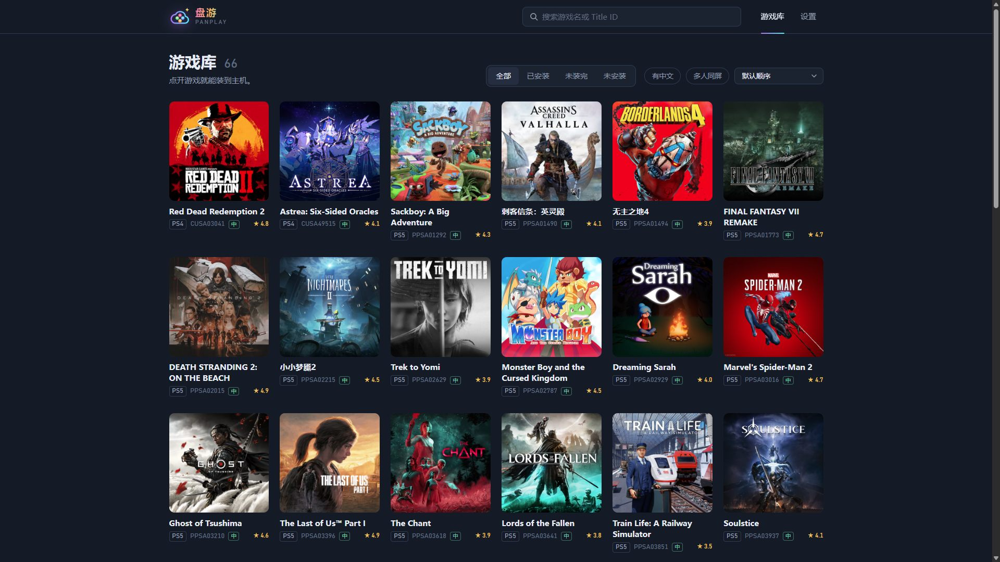
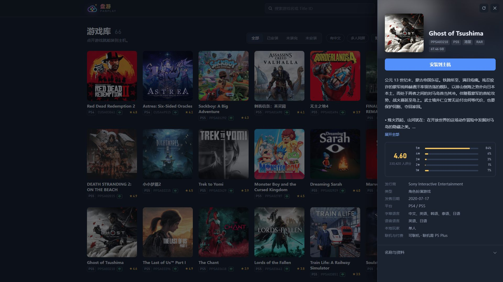

# 盘游 Panplay

把百度网盘里的 PS4 / PS5 游戏直接装进 PS5：边下载边解压，中间不落一份压缩包。断了下次接着装，出了新补丁只装补丁。

- 游戏按网盘文件夹列成封面墙，自动配上商店封面、中文名、评分和简介
- 用百度网盘 App 扫码登录，不用申请任何密钥
- 可以跑在电脑上通过 FTP 写进 PS5，也可以直接跑在 PS5 上；手机、平板在同一 Wi-Fi 里都能打开操作

**你需要**：一台已破解、能运行 payload 的 PS5。网盘里直接放游戏压缩包（ZIP / RAR / 7z，支持分卷）；压缩包里装的是游戏目录（带 `sce_sys` 的那种）或 exFAT 镜像，不是 `.pkg` 安装包。





## 开始使用

到 [Releases](https://github.com/cnwinds/pan-play/releases) 下载，两种跑法选一种。

### 跑在 PS5 上（不用开电脑）

1. 用 payload 加载器把 `panplay-<版本>-ps5.elf` 发送到主机。
2. 主机右上角通知会给出访问地址，用手机或电脑浏览器打开。
3. 第一次运行会在主机桌面装一个「盘游」图标，点它直接在主机上打开盘游。

盘游在后台运行，去玩游戏不影响它安装。游戏默认装到主机的 `/data/homebrew`，装完自动注册到主机桌面，在详情页删除时也会一起从桌面移除；运行游戏仍然需要 kstuff。

升级时先在设置页点「退出盘游」，再发送新版 elf：盘游已经在运行时，新发送的不会启动（通知里会说明）。正在运行的版本写在设置页「退出盘游」按钮上方，启动通知里也有。放进了自动加载的，记得把自动加载里的 elf 一起换成新版，不然重启后跑的还是旧版。

注册过的游戏每次开机要由盘游先挂好才能启动，所以建议把盘游放进自动加载（比如 plk-autoloader 的 `autoload.txt`），桌面上的盘游图标不用重装。盘游会接管 ShadowMountPlus 注册过的游戏，两者不要同时运行：ShadowMountPlus 开着时，盘游不注册也不挂载，交给它处理。

游戏的 backport 带了 `fakelib`（新固件的系统库）时，游戏启动时盘游会把它叠到游戏的系统库目录上，不用另外开 BackPork；BackPork 或 ShadowMountPlus 开着时交给它们。游戏在主机桌面上启动，盘游的详情页会显示最近一次启动的结果，比如 backport 库挂没挂上、游戏是不是启动后很快就退出了。

### 跑在 Windows 电脑上

PS5 上要开着 FTP 服务，建议用 [zftpd](https://github.com/seregonwar/zftpd)，盘游对它的断点续传做了专门适配。

1. 双击 `panplay-<版本>-windows-x64.exe`，浏览器会自动打开盘游。
2. 在设置的「存放位置」里选「FTP 发送到主机」，填 PS5 的地址和端口。

### 然后

1. 用百度网盘 App 扫码登录。
2. 在设置的「网盘」里填游戏库目录。
3. 回到游戏库，点一款游戏，点「安装到主机」。

要退出，在设置页点「退出盘游」。没装完的游戏下次启动会接着装；网络断开、主机休眠唤醒这类意外中断，会等一会儿自动接着装，已经装好的文件不重新下载。非固实的 RAR 会直接从停下的那个文件接着读，不再从第一卷重新核对。

## 网盘里怎么放

最省事的是配上 [盘架 PanShelf](https://github.com/cnwinds/pan-shelf)：盘架在电脑上采集资源站的游戏，把整份游戏清单（带分享链接）发布到网盘的 `/盘游/资源库.json`。盘游读到后，网盘里还没有的游戏也会列在游戏库里（封面上的大小画虚线框），点安装时盘游自己把它转存进网盘再装，不用先去盘架加入。两边的游戏库目录要是同一个，不一样时设置页会直接填成盘架的转存目录，点保存就行。

网盘空间由盘游管：设置的「网盘」里可以设游戏最多占用多少（默认 2048 GB）、网盘至少留出多少（默认 200 GB）。转存后超了，盘游边装边在后台把能再转回来的游戏移出网盘（网盘剩下的连这款都装不下时，转存前先腾出差的那些），先移已经装在主机上的，再移最久没用的；自己放进网盘的、链接已经失效的、别的设备正在装的不会动。装好的游戏在主机上不受影响，以后想重装再自动转回来。各台设备正在装什么记在网盘的 `/盘游/在用` 里。

盘架开了大模型分析时，还会给每个游戏排一份「安装编排」：哪组分卷是主游戏、补丁按什么顺序叠、分享里单独的文件（比如说明里要求覆盖进 `fakelib` 的系统库）放到游戏目录的哪里。盘游按 md5 在网盘里找到这些文件就照编排装，分卷散在几个子目录里也不要紧。有的游戏要装一个激活完整版、解锁 DLC 的小 PKG（比如双影奇境 DLC 目录里的那个），主机上的盘游装好游戏后会自动装上，网盘里单独放着的、打包在压缩包里解压到游戏目录的都认得；以前装好的游戏在「⋯」里点「注册到主机」会补装；这要求主机的破解环境支持安装自制 PKG，装没装上在详情页「要在主机上安装的包」里看。删掉游戏时这个包不单独卸，再装游戏时会重新装一遍。网盘里的文件和编排对不上、照编排装失败、你标了「有问题」，或者在详情页「⋯」里点「让盘架重新分析」，盘游都会经网盘的 `/盘游/反馈` 告诉盘架，盘架重新分析后资源库里的编排会更新。没有编排时照下面的规则装。

盘架转存时会把目录整理成下面的格式。

自己整理的话，一款游戏一个文件夹，名字里带 Title ID（`PPSA` 或 `CUSA` 加 5 位数字）。主游戏直接放在文件夹里，每个补丁单独一个子文件夹，按序号命名：

```
游戏库目录/
└── 对马岛之魂 PPSA03210/
    ├── Ghost.part1.rar        主游戏
    ├── Ghost.part2.rar
    ├── 补丁01 v1.05/
    │   └── Ghost-v1.05.rar
    └── 补丁02 v2.10/
        └── Ghost-v2.10.rar
```

出了新补丁，再加一个子文件夹，打开游戏详情点「安装更新」即可，主游戏不会重下。

同一款游戏有 exFAT 镜像版、文件夹版几份时，每种格式放一个 `@exfat`、`@folder`、`@other` 子文件夹（盘架按格式转存时自动这样放），装的时候在详情页选格式，默认选文件夹版（解压快得多）；主机上同一款游戏只装一种。文件夹版因为文件名大小写对不上玩不了的，可以换 exFAT 版试试：PS5 上的盘游会把镜像读写挂载、把 backport 写进镜像再注册到桌面，开机时也由盘游先挂好镜像。ShadowMountPlus 开着时盘游不挂镜像，免得两边同时写坏镜像。

装好的游戏可以标记「能玩」或「有问题」（带一句说明和当时的主机固件版本）。评价按压缩包的内容认，网盘目录改名、删了再转存回来都还在；同一个游戏的不同来源、不同格式各记各的，下次看到标了「有问题」的就不用再装了。装的时候发现压缩包里是 PKG 安装包，会自动标成「有问题」。评价会存到网盘的 `/盘游/评价` 里，PS5 和电脑上的盘游互相看得到对方的评价；[盘架](https://github.com/cnwinds/pan-shelf) 也读它，分享里的文件和标了「有问题」的那份一样时就不再转存。

游戏装好了不想再占网盘空间，或者装不了、玩不了，可以在详情页的「⋯」里点「从网盘删除」，像盘架的「退出网盘」一样把网盘里这个游戏的整个文件夹删掉，文件进百度网盘回收站。主机上装好的游戏不受影响，评价也还在，游戏库里照样有它（标着「网盘已删除」），想删主机上的那份时还在详情页里删。百度要求安全验证、不让直接删时，会改为移到网盘的 `/盘游/待删除`（和盘架共用），要在百度网盘 App 里清空这个文件夹才会腾出空间。没装完的游戏要先删掉已装的部分才能从网盘删除。

7z 请用 7-Zip 默认设置压缩，加了密码或用了 PPMd、BCJ2 的装不了。RAR 和 7z 解压时整个字典都要放进内存，字典超过设置里「解压」上限（默认 PC 4 GB、PS5 512 MB）的包会被拒绝并说明原因。字典按每个文件真正要用的算：非固实的 RAR 里比字典小的文件只要文件那么大，只存不压的不要字典，所以文件头写着 4 GB 字典、实际文件都不大的包照样能装；超过上限的大文件装到它才停，调高上限后从它接着装；调高上限后主机给不了那么多内存时，会停下报「内存不够」，不自动重试。字典用完马上还给系统。PS5 上调到 512 MB 以上也能装，但主机只给盘游约 1.5 GB 内存，放不下的字典要和硬盘来回交换，装得会明显变慢（设置页会提示）。安装时详情页进度条下面用一行小字显示这层压缩包的字典多大、最近主要慢在下载、解压、等内存换页还是写盘。更多细节见 [网盘游戏目录整理指南](docs/game-folder-guide.md)。

## 其他

- 局域网访问默认开着、不要口令。想限制别人打开，在设置的「局域网访问」里关掉或设口令。
- 设置和登录状态存在 `%APPDATA%\panplay`（Windows）或 `/data/panplay`（PS5）。其中的 `baidu-session.json` 就是你的网盘登录态，不要发给别人。
- 装得慢时，在设置的「网盘」里点「下载测速」：盘游在运行它的设备上（PS5 上跑就是主机本身）先用一条连接、再加到 2、4、8 条同时从网盘读数据，读到就丢、不解压不写盘，测完和最近一次安装的平均速度比一比，告诉你慢在下载还是解压写盘。
- 安装时一组分卷连着下，换卷不停顿。先用一条连接，一条吃不满才加，确认多开真的更快才留下；某条连接变慢或卡住时由别的连接接手，不让解压等着。用几条连接的结论按设备记在数据目录的 `download.json`，下次安装直接从这个条数开始。
- 运行日志是同一目录下的 `panplay.log`，平时只记启动、安装、删除和出错。每次安装结束都会记一行「安装耗时」，写明时间花在等下载、解压、写入、开关文件上各占多少，解压里有多少是在等内存换页，以及字典多大、装的时候主机上有没有在玩游戏，装得慢时看这一行就知道慢在哪。遇到问题时在设置的「日志」里打开详细日志，重现一次后点同一页的「下载日志」，把下载的文件发过来。
- 自己编译见 [从源码构建](docs/build.md)。

