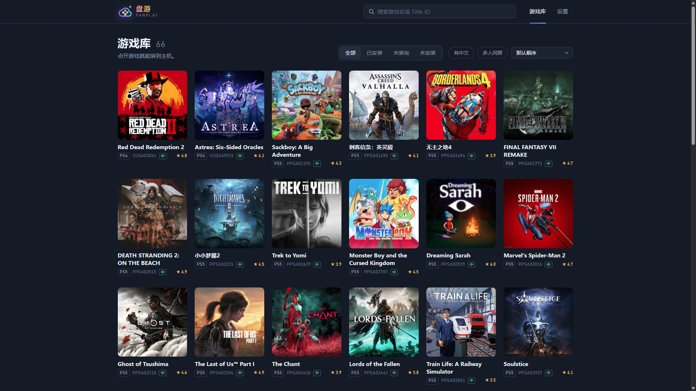
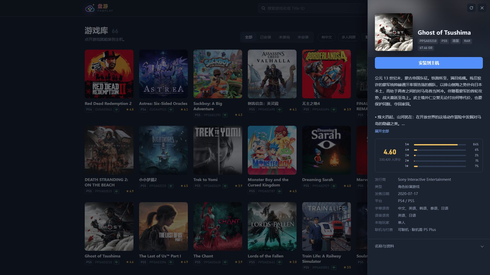

# 盘游 Panplay

把百度网盘里的 PS4 / PS5 游戏直接装进 PS5：边下载边解压，中间不落一份压缩包。断了下次接着装，出了新补丁只装补丁。

- 游戏按网盘文件夹列成封面墙，自动配上商店封面、中文名、评分和简介
- 用百度网盘 App 扫码登录，不用申请任何密钥
- 可以跑在电脑上通过 FTP 写进 PS5，也可以直接跑在 PS5 上；手机、平板在同一 Wi-Fi 里都能打开操作

**你需要**：一台已破解、能运行 payload 的 PS5。网盘里直接放游戏压缩包（ZIP / RAR / 7z，支持分卷）；压缩包里装的是游戏目录（带 `sce_sys` 的那种），不是 `.pkg` 安装包。





## 开始使用

到 [Releases](https://github.com/cnwinds/pan-play/releases) 下载，两种跑法选一种。

### 跑在 PS5 上（不用开电脑）

1. 用 payload 加载器把 `panplay-<版本>-ps5.elf` 发送到主机。
2. 主机右上角通知会给出访问地址，用手机或电脑浏览器打开。
3. 第一次运行会在主机桌面装一个「盘游」图标，点它直接在主机上打开盘游。

盘游在后台运行，去玩游戏不影响它安装。游戏默认装到主机的 `/data/homebrew`，装完自动注册到主机桌面，在详情页删除时也会一起从桌面移除；运行游戏仍然需要 kstuff。

注册过的游戏每次开机要由盘游先挂好才能启动，所以建议把盘游放进自动加载（比如 plk-autoloader 的 `autoload.txt`），桌面上的盘游图标不用重装。盘游会接管 ShadowMountPlus 注册过的游戏，两者不要同时运行：ShadowMountPlus 开着时，盘游不注册也不挂载，交给它处理。

### 跑在 Windows 电脑上

PS5 上要开着 FTP 服务，建议用 [zftpd](https://github.com/seregonwar/zftpd)，盘游对它的断点续传做了专门适配。

1. 双击 `panplay-<版本>-windows-x64.exe`，浏览器会自动打开盘游。
2. 在设置的「存放位置」里选「FTP 发送到主机」，填 PS5 的地址和端口。

### 然后

1. 用百度网盘 App 扫码登录。
2. 在设置的「网盘」里填游戏库目录。
3. 回到游戏库，点一款游戏，点「安装到主机」。

要退出，在设置页点「退出盘游」。没装完的游戏下次启动会接着装；网络断开、主机休眠唤醒这类意外中断，会等一会儿自动接着装，已经装好的文件不重新下载。

## 网盘里怎么放

网盘里的游戏建议用 [盘架 PanShelf](https://github.com/cnwinds/pan-shelf) 来管理：它从资源站把游戏转存进网盘，目录自动整理成下面的格式，不用的游戏一键移出网盘腾空间。

自己整理的话，一款游戏一个文件夹，名字里带 Title ID（`PPSA` 或 `CUSA` 加 5 位数字）。主游戏直接放在文件夹里，每个补丁单独一个子文件夹，按序号命名：

```
游戏库目录/
└── 对马岛之魂 PPSA03210/
    ├── Ghost.part1.rar        主游戏
    ├── Ghost.part2.rar
    ├── 补丁01 v1.05/
    │   └── Ghost-v1.05.rar
    └── 补丁02 v2.10/
        └── Ghost-v2.10.rar
```

出了新补丁，再加一个子文件夹，打开游戏详情点「安装更新」即可，主游戏不会重下。

装好的游戏可以标记「能玩」或「有问题」（带一句说明和当时的主机固件版本）。评价按压缩包的内容认，网盘目录改名、删了再转存回来都还在；同一个游戏的不同来源各记各的，下次看到标了「有问题」的就不用再装了。

7z 请用 7-Zip 默认设置压缩，加了密码或用了 PPMd、BCJ2 的装不了。RAR 和 7z 解压时整个字典都要放进内存，字典超过设置里「解压」上限（默认 PC 4 GB、PS5 512 MB）的包会被拒绝并说明原因。更多细节见 [网盘游戏目录整理指南](docs/game-folder-guide.md)。

## 其他

- 局域网访问默认开着、不要口令。想限制别人打开，在设置的「局域网访问」里关掉或设口令。
- 设置和登录状态存在 `%APPDATA%\panplay`（Windows）或 `/data/panplay`（PS5）。其中的 `baidu-session.json` 就是你的网盘登录态，不要发给别人。
- 运行日志是同一目录下的 `panplay.log`，平时只记启动、安装、删除和出错。遇到问题时在设置的「日志」里打开详细日志，重现一次后把 `panplay.log` 发过来。
- 自己编译见 [从源码构建](docs/build.md)。

