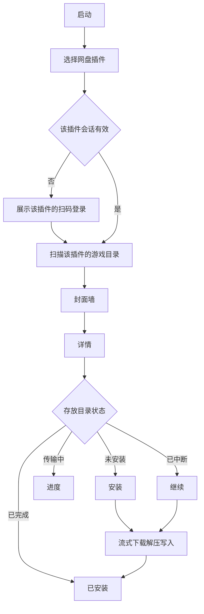

# 盘游 Panplay 产品需求文档

中文名定为 **盘游**：盘是网盘，游是把游戏装来玩。英文名定为 **Panplay**，与两个字逐一对应，也用作程序和仓库名。

## 1. 概述

盘游给已经把 PS5 游戏分卷放在自己百度网盘里的人用。网盘是插件，核心只认统一接口；本期只带百度插件，夸克和其他网盘以后按同一接口加进来。用户扫码登录，软件扫描设置好的路径，用目录名里的 Title ID 对照本地游戏资料，再从 PlayStation 港服商店补上中文名和官方封面，以封面墙展示。点进详情后，若 PS5 存放目录里还没有这款游戏，就显示安装；传输中和中断后可以继续；完成后显示已安装。安装过程流式下载并解压，分卷不在本地或主机上再存一份压缩包。

同一套核心同时跑在 PC 上，以及已能加载自制 ELF 的 PS5 上。PC 上的存放位置可以是本机目录，也可以是主机上的 FTP 目录。PS5 上直接写本机目录。

## 2. 问题

使用者要把网盘里按游戏分好的分卷压缩包，装进 PS5 能读到的目录。现在需要自己分辨目录、找封面、手动下载、解压、续传，中断后往往从头再来。盘游把浏览、识别、安装和续传收成一条商店式流程。

## 3. 使用者

主要使用者是管理自己百度网盘游戏库的人。用户用百度 App、百度网盘或微信扫码，希望用封面挑选，而不是对着文件名操作。PC 和 PS5 都要能完成同一条流程。PS5 上用加载器发送载荷，载荷在后台常驻，用手机浏览器操作它提供的页面；载荷还会在主机桌面装一个图标，点开用主机自带的浏览器打开同一个页面。装到主机本机的游戏由盘游注册到主机桌面、删除时注销、开机时恢复挂载，不依赖 ShadowMountPlus（见 ADR 0003）。换网盘时不改封面墙和安装流程，但本期不提供第二个网盘。

## 4. 背景

技术边界已经核对过，写入本期约束：

- 网盘能力收成插件接口：发起扫码、轮询登录、退出、会话是否有效、按路径列出子项、按文件标识和字节偏移读取。封面墙、匹配、解压、续传和写入只调用这个接口。
- 百度插件走网盘网页版的扫码登录：passport 给出二维码 `qrcode_url`，用户用百度网盘 App 扫码并确认，插件换得 `BDUSS` / `STOKEN` cookie，之后列目录和取下载地址都带这组 cookie，不需要开放平台应用和密钥。下载地址约 8 小时失效，插件重新获取后仍按原偏移读取。
- 夸克不在本期实现。2026-10-12 已确认不能靠脚本自己取码：App 会提示登录请求过期。以后若做夸克插件，登录必须走夸克网页自己生成的二维码，并且先通过列目录和按偏移读取验收。
- ZIP、分卷 ZIP、7z 分卷、RAR 分卷都可以流式解压后直接写入目标。7z 先读取很小的头部。RAR 使用替换了读取层的解压器。
- 已通过校验的文件不重做。Deflate 可以按解压现场续。非固实 RAR 记下停下的位置，续装时直接从那一卷、那个文件接着读，前面的分卷不再重读。7z 和 RAR 的固实压缩块中断后，从该块起点重新拉取压缩数据，已完成文件仍然跳过。
- RAR 和 7z 的字典超过设置里的上限时拒绝安装，并说明字典多大、上限多少、怎么处理。上限默认 PC 4 GB、PS5 512 MB，可以在设置的「解压」里改，也可以不限制。不限制时要不到字典内存就停下报「内存不够」，不自动重试。
- 已装好的游戏可以在详情页删除，要确认两次，删掉整个游戏文件夹。
- 安装中显示平均速度、剩余时间和预计几点装完；装完后显示用时和平均速度。
- 完成标记写好之后，目录布局能被现有的主机挂载工具扫描。盘游本身不挂载游戏。
- 索尼没有对第三方开放的、同时带 Title ID、商店封面和简介的游戏库。可用的是两层公开数据：
  - `PlayStation-Titles` 提供 PS4/PS5 的 Title ID、名称、`conceptId` 和区域，MIT 许可，作者每天自动刷新。名称基本是英文：PS5 约 2.3 万条里带汉字的只有 660 条，港亚区条目也多为英文名。
  - PlayStation 商店的概念页 `store.playstation.com/{地区}/concept/{conceptId}` 内嵌结构化数据，包含该地区语言的游戏名、方形主视觉、类型、发行商、发售日和简介。`conceptId` 跨区通用，同一款游戏的美版、欧版、港版指向同一个概念。港服有简体中文地区 `zh-hans-hk` 和繁体中文地区 `zh-hant-hk`。
- 游戏盘本身的 `sce_sys/param.json` 和 `icon0.png` 也有官方名称和图标，但网盘里是分卷压缩包：ZIP 可以低成本预读，非固实 RAR 要逐个读文件头，固实 RAR 必须从头解压，零售 PKG 又是加密的。本期不从压缩包里取资料。

## 5. 方案

每个网盘插件对核心提供同一组能力：显示名称、扫码登录、轮询、退出、列目录、按偏移读取。插件自己保存登录凭证。核心不出现某个网盘的接口地址。更换或新增网盘时，封面墙、资料匹配、解压和写入保持不变。本期只注册百度插件。设置和安装任务仍按插件标识保存，方便以后加插件时不用改这些数据。不从网上加载未随版本发布的插件。

设置里先选网盘插件，再按该插件声明的参数填写（百度没有参数，扫码登录即可），以及它的游戏库路径。参数、路径和登录状态按插件标识保存，切换插件不会丢。存放位置先选保存方式：本机文件夹（游戏直接装在该文件夹下），或 FTP 发送到主机（填主机地址、端口和主机目录）。PS5 上只有本机文件夹。

扫描时，把当前插件路径下的每个子目录当作一款游戏。压缩包可以在该目录内，也可以再下一层。安装任务记下插件标识和文件标识，继续时仍走原来的插件。

游戏资料以 `conceptId` 为唯一主键，查法如下：

1. 从目录名抽出 Title ID（`CUSA` / `PPSA` 加五位数字），在本地的 `PlayStation-Titles` 里换成英文名和 `conceptId`。这一步只读本地文件。
2. 按 `conceptId` 查本机商店资料缓存，命中就直接用。
3. 没命中时，后台依次请求港服简体概念页、港服繁体概念页、美服概念页，取第一个收录了这款游戏的地区。取到的名称、封面、类型、发行商、发售日、简介（优先长简介）、评分与各星级占比、字幕和语音语言、平台、本地人数、联机方式、是否需要 PS Plus、是否含内购和版本写入本机缓存；封面按 440 像素宽下载到本机，页面只从本机读取。
4. 三个地区都没有收录时，记为未收录，显示 `PlayStation-Titles` 的英文名和占位封面。

展示名的优先级是：用户手动改的名字，商店名称，`PlayStation-Titles` 英文名，网盘目录名。目录名里没有 Title ID 时，不按名字猜测商店结果，直接显示目录名，用户可以手动改名。

商店请求只在后台进行，不阻塞游戏列表。每秒最多一次请求。取到的资料 30 天后在后台刷新；未收录的记录 7 天后再试；网络失败不写缓存，稍后重试。缓存里由旧版本取到、缺少新字段的资料在后台重抓补全，期间照常显示旧资料，不重下封面，没取到时保留旧资料。商店页面结构变化导致解析失败时，降级为英文名，扫描和安装不受影响。

封面墙按商店货架展示封面和名称，有中文字幕或语音的标“中”，有评分的显示星级。可以只看有中文的、只看支持两人以上同屏的，可以按评分、发售日期或名称排序。详情包含封面、名称、名称来源、简介（过长时折叠）、评分与各星级占比、类型、发行商、发售日、平台、版本、字幕和语音语言、本地人数、联机与付费说明和网盘分卷总大小，并可以修改展示名。主按钮只有四种结果：安装、进度、继续、已安装。

同一时间只有一个安装任务在跑。再点另一款游戏时，排进队列，当前任务结束后自动开始。进度展示当前游戏、阶段（下载、解压、写入）、已完成文件数和大致百分比。暂停后状态变为已中断，按钮变为继续。

已安装的判定是：目标目录中该游戏的完成标记存在，且标记里的校验和与本次资料一致。标记只在全部分卷解压并逐文件校验通过后写入。有文件但没有标记时视为已中断，显示继续。

## 6. 成功标准

- 主指标：在百度插件上，从扫码到一款已匹配游戏显示「已安装」，用户中途不需要手工拷贝、解压或改文件名。
- 插件：封面墙、详情、安装、继续和已安装只通过网盘接口完成，不直接调用百度接口。
- 续传：安装中断后，再次打开并点击继续，已校验通过的文件不重传，最终仍能变成已安装。
- 识别：目录名含 Title ID、且港服在售的游戏，显示港服中文名和官方封面；美版目录也能通过 `conceptId` 拿到中文名。
- 守护：分卷压缩包不在 PC 或 PS5 上落成完整文件；令牌只保存在本机。

## 7. 用户故事与验收

人物：管理自己网盘游戏库的玩家。

**扫码登录**

作为玩家，我要看到百度登录二维码并用手机扫码，以便不用在主机上输入账号。登录走百度插件，页面不出现百度接口细节。

- 场景：首次打开且没有有效会话。当进入登录。则展示百度设备码二维码和过期倒计时，并按接口要求的间隔轮询。
- 场景：扫码成功。当轮询得到会话。则进入封面墙，并由百度插件保存自己的凭证。
- 场景：二维码过期。当超过有效期仍未授权。则更换新二维码。
- 场景：再次打开。给定会话仍有效或刷新成功。则不再显示二维码。

**设置路径**

作为玩家，我要为当前网盘设定游戏库路径，并设定 PS5 存放目录，以便软件知道从哪读、写到哪。

- 场景：保存设置。当选好网盘插件、填入它的参数和游戏库路径，并选好本机文件夹或 FTP。则之后的扫描和安装都使用这些设置，参数和路径记在该插件名下。
- 场景：路径无效。当游戏库路径不存在或存放目录没有写权限。则说明原因，不开始扫描或安装。

**扫描并匹配**

作为玩家，我要软件读出网盘里的游戏目录并配上封面，以便按游戏而不是按压缩包浏览。

- 场景：目录名含 Title ID，港服在售。当扫描到该子目录。则先显示本地标题库的英文名，后台取到港服资料后换成中文名和官方封面。
- 场景：美版目录。给定 Title ID 属于美服，但同一 `conceptId` 在港服在售。则同样显示港服中文名。
- 场景：港服没有收录。则依次试港服繁体、美服，取到哪个就用哪个，详情标明名称来源。
- 场景：商店都没有收录，或目录名里没有 Title ID。则显示英文名或目录名和占位封面，详情标明未收录，安装流程照常可用。
- 场景：手动改名。当用户在详情里填写名称并保存。则封面墙和详情都用这个名字，商店刷新不会覆盖；清空后恢复自动名称。
- 场景：商店暂时连不上。则先显示已有名称，网络恢复后自动补齐。

**封面墙与详情**

作为玩家，我要像逛商店一样看封面并点进详情，以便决定装哪款。

- 场景：打开封面墙。给定扫描完成。则每款游戏一张封面和名称。
- 场景：打开详情。当点某一款。则看到简介、分类信息和分卷总大小，以及与当前安装状态对应的主按钮。

**安装、继续和已安装**

作为玩家，我要点一次就把游戏装进 PS5 目录，中断后能接着装，装完后能看出已经装好。

- 场景：未安装。给定存放目录没有该游戏的完成标记。则主按钮为「安装」。
- 场景：开始安装。当点击安装。则通过当前网盘插件按分卷顺序读取，流式解压写入存放目录，不把压缩包写成文件。任务记下插件标识和文件标识。
- 场景：正在传输。则主按钮变为进度，能看到阶段和完成比例，并能暂停。
- 场景：暂停或进程中断。则状态为已中断，主按钮为「继续」。
- 场景：继续。当点击继续。则已校验文件跳过，未完成文件接着写。
- 场景：安装完成。当全部文件校验通过。则写入完成标记，主按钮变为「已安装」，且不能再次安装覆盖。
- 场景：固实压缩中断后继续。则从该压缩块起点重新拉取，已完成文件不重写。
- 场景：字典超过上限。当 RAR 或 7z 的字典超过设置里的上限。则不开始解压，说明字典大小和上限，提示调高上限后重试或用更小的字典重新压缩。
- 场景：解压内存不够。当解压时要不到放字典的内存。则停下报错，说明字典多大，不自动重试；提示关掉其他程序后重试、调低字典上限或用更小的字典重新压缩。字典用完马上还给系统，不长期占着主机内存。

## 8. 本期不做

- 在盘游里挂载或启动游戏
- 购买、支付、账号商城
- 同一个网盘插件里同时登录多个账号
- 夸克网盘插件，以及其他第二个网盘
- 从网上安装未随版本发布的网盘插件
- 批量抓取 PlayStation Store：只按用户库里游戏的 `conceptId` 逐个读取概念页，不预先爬取整个商店
- 从网盘压缩包或 PKG 里预读 `param.json`、`icon0.png`
- 资料库的可视化编辑后台
- 金手指、补丁合并、存档管理
- 一个游戏同时开多条下载

## 9. 依赖与风险

- 百度插件依赖网盘网页版的 passport 扫码登录接口和 `/api/filemetas`、`xpan/file?method=list` 的 cookie 鉴权，这些不是公开承诺的接口，百度改版时要跟着调整；登录、列目录、取下载地址集中在 `baidu_drive.cpp`。
- 依赖 `PlayStation-Titles` 数据。它由个人维护，停更后新游戏查不到 `conceptId`；本机始终保留最后一份可用数据，同步地址可用环境变量 `PANPLAY_CATALOG_URL` 换成镜像。
- 依赖 PlayStation 商店概念页的内嵌数据结构。结构变化时只影响中文名和封面，解析集中在一处并有自检覆盖。
- 风险：港服未上架的游戏只有英文名。处理是手动改名。
- 依赖 PC 或 PS5 能访问百度下载地址；PS5 侧还依赖自制 ELF 加载环境。
- 风险：目录名和资料对不上。处理是占位展示加一次手工选定。
- 风险：固实大包续传要重拉当前压缩块，耗时长。界面说明「正在从中断处的压缩块继续」，不假装能从任意字节接着解。
- 风险：局域网页面暴露令牌。面向家庭内网，默认局域网可访问、不要口令；需要的人在设置里开访问口令。令牌不写进前端可复制的地址，按域名打开的页面一律拒绝，挡住 DNS 重绑定。

## 10. 已定决策

- 网盘是插件。核心只依赖统一的登录、列目录和按偏移读取接口。本期只实现百度插件。
- 登录用百度设备码二维码，页面不嵌入账号密码框。
- Title ID 到 `conceptId` 的对照以 `PlayStation-Titles` 为准。中文名、封面、简介、类型和发行商以 PlayStation 商店概念页为准，地区顺序是港服简体、港服繁体、美服。同一 `conceptId` 的区域版本视为同一款游戏。不使用 IGDB 和包装图标站点。
- 展示名优先级：用户手动改名 > 商店名称 > `PlayStation-Titles` 英文名 > 网盘目录名。
- 已安装只看完成标记，不靠「目录里有一些文件」来判断。
- PC 与 PS5 共用核心和同一套页面。先把 PC 版做完并验证，再做 PS5 载荷。
- PC 验证使用项目里的 dummy FTP。它只监听本机，用一个目录模拟 PS5 的 FTP 根；安装仍按远端 `SIZE` 与已提交字节决定追加或覆盖。

