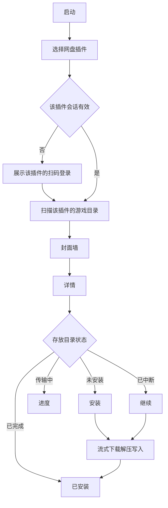

# 盘游 Panplay 产品需求文档

中文名定为 **盘游**：盘是网盘，游是把游戏装来玩。英文名定为 **Panplay**，与两个字逐一对应，也用作程序和仓库名。

## 1. 概述

盘游给已经把 PS5 游戏分卷放在自己百度网盘里的人用。网盘是插件，核心只认统一接口；本期只带百度插件，夸克和其他网盘以后按同一接口加进来。用户扫码登录，软件扫描设置好的路径，用目录名对照本地游戏资料，以封面墙展示。点进详情后，若 PS5 存放目录里还没有这款游戏，就显示安装；传输中和中断后可以继续；完成后显示已安装。安装过程流式下载并解压，分卷不在本地或主机上再存一份压缩包。

同一套核心同时跑在 PC 上，以及已能加载自制 ELF 的 PS5 上。PC 上的存放位置可以是本机目录，也可以是主机上的 FTP 目录。PS5 上直接写本机目录。

## 2. 问题

使用者要把网盘里按游戏分好的分卷压缩包，装进 PS5 能读到的目录。现在需要自己分辨目录、找封面、手动下载、解压、续传，中断后往往从头再来。盘游把浏览、识别、安装和续传收成一条商店式流程。

## 3. 使用者

主要使用者是管理自己百度网盘游戏库的人。用户用百度 App、百度网盘或微信扫码，希望用封面挑选，而不是对着文件名操作。PC 和 PS5 都要能完成同一条流程。PS5 上用手机浏览器操作载荷提供的页面。换网盘时不改封面墙和安装流程，但本期不提供第二个网盘。

## 4. 背景

技术边界已经核对过，写入本期约束：

- 网盘能力收成插件接口：发起扫码、轮询登录、退出、会话是否有效、按路径列出子项、按文件标识和字节偏移读取。封面墙、匹配、解压、续传和写入只调用这个接口。
- 百度插件走开放平台设备码模式，返回 `qrcode_url`，用户用百度 App、百度网盘或微信扫码。下载地址约 8 小时失效，插件重新获取后仍按原偏移读取。
- 夸克不在本期实现。2026-10-12 已确认不能靠脚本自己取码：App 会提示登录请求过期。以后若做夸克插件，登录必须走夸克网页自己生成的二维码，并且先通过列目录和按偏移读取验收。
- ZIP、分卷 ZIP、7z 分卷、RAR 分卷都可以流式解压后直接写入目标。7z 先读取很小的头部。RAR 使用替换了读取层的解压器。
- 已通过校验的文件不重做。Deflate 可以按解压现场续。7z 和 RAR 的固实压缩块中断后，从该块起点重新拉取压缩数据，已完成文件仍然跳过。
- PS5 上 LZMA 字典超过 128MB 的包拒绝安装并说明原因。PC 上允许更大字典。
- 完成标记写好之后，目录布局能被现有的主机挂载工具扫描。盘游本身不挂载游戏。
- 索尼没有对第三方开放的、同时带 Title ID、商店封面和简介的游戏库。可用的是两层公开数据：`PlayStation-Titles` 提供 PS4/PS5 的 Title ID、名称、`conceptId` 和区域，MIT 许可，可随软件离线携带；IGDB 提供商店级封面、简介、类型和开发商，按游戏名查询，需要 Twitch 应用凭证。同一游戏的不同区域 Title ID 用 `conceptId` 归成一条。PROSPEROPatches 和 ORBISPatches 能按 `PPSA` / `CUSA` 对到包装图标，只在 IGDB 没有封面时作补充。

## 5. 方案

每个网盘插件对核心提供同一组能力：显示名称、扫码登录、轮询、退出、列目录、按偏移读取。插件自己保存登录凭证。核心不出现某个网盘的接口地址。更换或新增网盘时，封面墙、资料匹配、解压和写入保持不变。本期只注册百度插件。设置和安装任务仍按插件标识保存，方便以后加插件时不用改这些数据。不从网上加载未随版本发布的插件。

设置里填写百度游戏库路径，以及 PS5 游戏存放目录。路径和登录状态按插件标识保存。PC 的存放目录可以选择本机文件夹或 FTP 地址。PS5 上只有本机文件夹。本期界面不提供网盘切换。

扫描时，把当前插件路径下的每个子目录当作一款游戏。压缩包可以在该目录内，也可以再下一层。匹配顺序是：从目录名抽出 Title ID（`CUSA` / `PPSA` 加五位数字），在本地的 `PlayStation-Titles` 里换成游戏名和 `conceptId`；再用这个名字向 IGDB 要封面、简介、类型和开发商。目录名里没有 Title ID 时，直接用规范化后的目录名查 IGDB。多个结果让用户选一次并记住。IGDB 没有封面时，再按 Title ID 取 PROSPEROPatches 或 ORBISPatches 的包装图标。两处都没有时仍显示该目录，使用占位封面，详情标明未收录，安装流程照常可用。查到的封面和简介缓存在本机。安装任务记下插件标识和文件标识，继续时仍走原来的插件。

封面墙按商店货架展示封面和名称。详情包含封面、名称、简介、类型、开发商、发行信息和网盘分卷总大小。主按钮只有四种结果：安装、进度、继续、已安装。

同一时间只有一个安装任务在跑。再点另一款游戏时，排进队列，当前任务结束后自动开始。进度展示当前游戏、阶段（下载、解压、写入）、已完成文件数和大致百分比。暂停后状态变为已中断，按钮变为继续。

已安装的判定是：目标目录中该游戏的完成标记存在，且标记里的校验和与本次资料一致。标记只在全部分卷解压并逐文件校验通过后写入。有文件但没有标记时视为已中断，显示继续。

## 6. 成功标准

- 主指标：在百度插件上，从扫码到一款已匹配游戏显示「已安装」，用户中途不需要手工拷贝、解压或改文件名。
- 插件：封面墙、详情、安装、继续和已安装只通过网盘接口完成，不直接调用百度接口。
- 续传：安装中断后，再次打开并点击继续，已校验通过的文件不重传，最终仍能变成已安装。
- 识别：目录名含 Title ID 时，先对上 `PlayStation-Titles` 里的游戏名，再显示 IGDB 封面；IGDB 没有封面时显示包装图标。
- 守护：分卷压缩包不在 PC 或 PS5 上落成完整文件；令牌只保存在本机。

## 7. 用户故事与验收

人物：管理自己网盘游戏库的玩家。

**扫码登录**

作为玩家，我要看到百度登录二维码并用手机扫码，以便不用在主机上输入账号。登录走百度插件，页面不出现百度接口细节。

- 场景：首次打开且没有有效会话。当进入登录。则展示百度设备码二维码和过期倒计时，并按接口要求的间隔轮询。
- 场景：扫码成功。当轮询得到会话。则进入封面墙，并由百度插件保存自己的凭证。
- 场景：二维码过期。当超过有效期仍未授权。则更换新二维码。
- 场景：再次打开。给定会话仍有效或刷新成功。则不再显示二维码。

**设置路径**

作为玩家，我要为当前网盘设定游戏库路径，并设定 PS5 存放目录，以便软件知道从哪读、写到哪。

- 场景：保存设置。当填入百度游戏库路径，以及本机目录或 PC 上的 FTP 地址。则之后的扫描和安装都使用这对路径，并记下它们属于百度插件。
- 场景：路径无效。当游戏库路径不存在或存放目录没有写权限。则说明原因，不开始扫描或安装。

**扫描并匹配**

作为玩家，我要软件读出网盘里的游戏目录并配上封面，以便按游戏而不是按压缩包浏览。

- 场景：目录名含 Title ID。当扫描到该子目录。则用本地标题库得到游戏名，并用 IGDB 的封面和简介展示。
- 场景：只有游戏名。当 IGDB 在 PS5 或 PS4 上只有一个明确结果。则使用该结果的封面和简介。
- 场景：匹配到多个。当无法唯一确定。则请用户选择一次，并记住选择。
- 场景：IGDB 没有封面，但 Title ID 能对上包装图标。则封面用该图标，详情仍尽量显示已有简介。
- 场景：标题库和 IGDB 都没有该游戏。则显示目录名和占位封面，详情标明未收录。

**封面墙与详情**

作为玩家，我要像逛商店一样看封面并点进详情，以便决定装哪款。

- 场景：打开封面墙。给定扫描完成。则每款游戏一张封面和名称。
- 场景：打开详情。当点某一款。则看到简介、分类信息和分卷总大小，以及与当前安装状态对应的主按钮。

**安装、继续和已安装**

作为玩家，我要点一次就把游戏装进 PS5 目录，中断后能接着装，装完后能看出已经装好。

- 场景：未安装。给定存放目录没有该游戏的完成标记。则主按钮为「安装」。
- 场景：开始安装。当点击安装。则通过当前网盘插件按分卷顺序读取，流式解压写入存放目录，不把压缩包写成文件。任务记下插件标识和文件标识。
- 场景：正在传输。则主按钮变为进度，能看到阶段和完成比例，并能暂停。
- 场景：暂停或进程中断。则状态为已中断，主按钮为「继续」。
- 场景：继续。当点击继续。则已校验文件跳过，未完成文件接着写。
- 场景：安装完成。当全部文件校验通过。则写入完成标记，主按钮变为「已安装」，且不能再次安装覆盖。
- 场景：固实压缩中断后继续。则从该压缩块起点重新拉取，已完成文件不重写。
- 场景：PS5 上字典过大。当 7z 字典超过 128MB。则不开始写入，并说明该包无法在主机上安装。

## 8. 本期不做

- 在盘游里挂载或启动游戏
- 购买、支付、账号商城
- 同一个网盘插件里同时登录多个账号
- 夸克网盘插件，以及其他第二个网盘
- 从网上安装未随版本发布的网盘插件
- 抓取 PlayStation Store 网页
- 资料库的可视化编辑后台
- 金手指、补丁合并、存档管理
- 一个游戏同时开多条下载

## 9. 依赖与风险

- 百度插件依赖开发者在百度网盘开放平台上的应用，以及 `basic,netdisk` 权限。
- 依赖随软件携带的 `PlayStation-Titles` 数据，以及一个可用的 IGDB / Twitch 应用凭证。包装图标只作封面补位。
- 依赖 PC 或 PS5 能访问百度下载地址；PS5 侧还依赖自制 ELF 加载环境。
- 风险：目录名和资料对不上。处理是占位展示加一次手工选定。
- 风险：固实大包续传要重拉当前压缩块，耗时长。界面说明「正在从中断处的压缩块继续」，不假装能从任意字节接着解。
- 风险：局域网页面暴露令牌。页面需要访问口令，令牌不写进前端可复制的地址。

## 10. 已定决策

- 网盘是插件。核心只依赖统一的登录、列目录和按偏移读取接口。本期只实现百度插件。
- 登录用百度设备码二维码，页面不嵌入账号密码框。
- 游戏名和 Title ID 以 `PlayStation-Titles` 为准，商店级封面和简介以 IGDB 为准。同一 `conceptId` 的区域版本视为同一款游戏。
- 已安装只看完成标记，不靠「目录里有一些文件」来判断。
- PC 与 PS5 共用核心和同一套页面。先把 PC 版做完并验证，再做 PS5 载荷。
- PC 验证使用项目里的 dummy FTP。它只监听本机，用一个目录模拟 PS5 的 FTP 根；安装仍按远端 `SIZE` 与已提交字节决定追加或覆盖。

